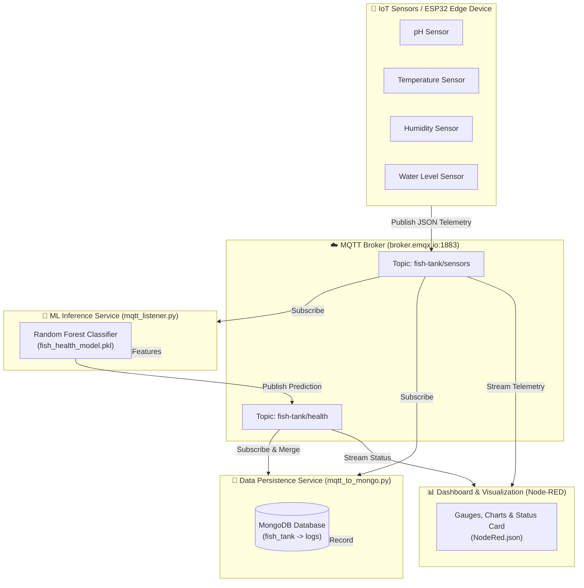
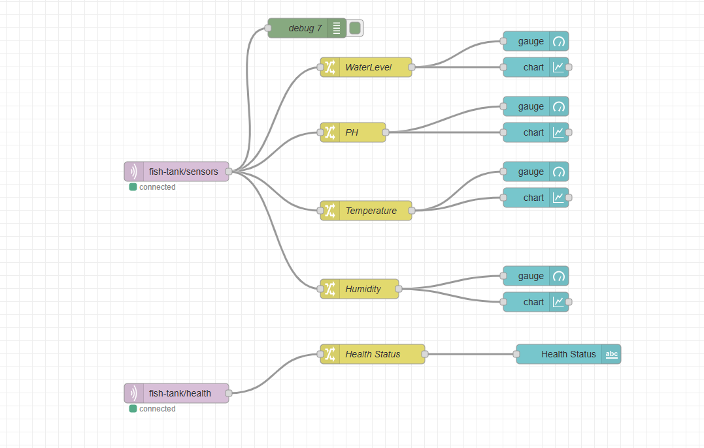
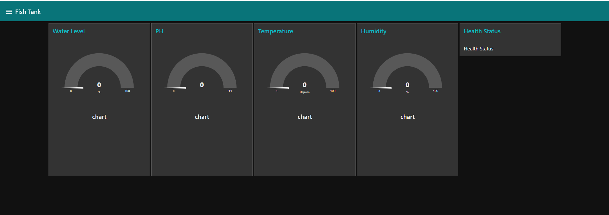

# 🐟 Smart IoT Fish Tank Health Monitoring & Prediction System

[](https://github.com/lasithhaputhanthri/fish_tank_health)
[](https://www.python.org/)
[](https://scikit-learn.org/)
[](https://mqtt.org/)
[](https://www.mongodb.com/)
[](https://nodered.org/)
[](LICENSE)

An end-to-end intelligent IoT aquaculture monitoring system that continuously tracks vital fish tank environmental parameters (pH, Temperature, Humidity, and Water Level), predicts fish habitat health using a trained Random Forest machine learning model in real-time, logs telemetry to MongoDB, and visualizes live status on an interactive Node-RED dashboard.

---

## 📌 Table of Contents

- [Overview](#-overview)
- [System Architecture](#-system-architecture)
- [Key Features](#-key-features)
- [Technology Stack](#-technology-stack)
- [Repository Structure](#-repository-structure)
- [Machine Learning Model](#-machine-learning-model)
- [MQTT Communication Protocol](#-mqtt-communication-protocol)
- [Database Schema (MongoDB)](#-database-schema-mongodb)
- [Node-RED Dashboard & Flow](#-node-red-dashboard--flow)
- [Getting Started](#-getting-started)
  - [Prerequisites](#prerequisites)
  - [Installation](#installation)
  - [Running the Services](#running-the-services)
- [Testing & Telemetry Simulation](#-testing--telemetry-simulation)
- [Contributing](#-contributing)
- [License](#-license)

---

## 🌟 Overview

Maintaining optimal water quality and environmental balance is critical for fish survival and aquatic ecosystem health. Sudden fluctuations in pH, water level, or temperature can cause severe stress or mortality.

This system provides:
1. **Continuous Telemetry Acquisition**: Real-time sensor readings streamed via MQTT.
2. **Edge/Cloud ML Inference**: Instant classification into **"Healthy"** or **"Non-Healthy"** conditions.
3. **Automated Logging**: Synchronized sensor data and prediction storage in MongoDB.
4. **Intuitive Visualization**: Real-time Node-RED dashboard with live gauges, historical trend charts, and status indicators.

---

## 🏗️ System Architecture



---

## ✨ Key Features

- **Real-Time Classification**: Automatically evaluates multi-parameter water health using a 100-estimator Random Forest model.
- **Decoupled Architecture**: MQTT publish/subscribe messaging ensures loose coupling between hardware, machine learning, database, and presentation layers.
- **Persistent Historical Logs**: Automatically correlates incoming sensor readings with inferred health states and writes timestamped documents to MongoDB.
- **Responsive Dashboard**: Beautiful Node-RED dark-themed dashboard showing real-time radial gauges, trend lines, and health badges.
- **Lightweight & Portable**: Fully Python-based backend that can run on an edge gateway (e.g., Raspberry Pi) or any local/cloud server.

---

## 💻 Technology Stack

| Layer | Component | Description |
| :--- | :--- | :--- |
| **Language** | Python 3.8+ | Core scripting, ML pipeline, and backend services |
| **Machine Learning** | Scikit-Learn, Pandas, Joblib | Model training, serialization, and real-time prediction |
| **Messaging** | MQTT (`paho-mqtt`), EMQX Broker | Real-time lightweight publish/subscribe transport |
| **Database** | MongoDB (`pymongo`) | Document database for telemetry and inference logs |
| **Visualization** | Node-RED (`node-red-dashboard`) | Flow-based dashboard for real-time visualization |

---

## 📁 Repository Structure

```text
fish_tank_health/
├── dataset.csv                  # 1,000-row labeled training dataset
├── train_model.py               # ML training script (Random Forest)
├── fish_health_model.pkl        # Serialized trained Random Forest model
├── mqtt_listener.py             # MQTT listener: predicts status and publishes to MQTT
├── mqtt_to_mongo.py             # MQTT listener: aggregates metrics and logs to MongoDB
├── NodeRed.json                 # Exported Node-RED flow configuration
├── NodeRedfFlow.png             # Node-RED visual flow diagram
├── NodeRedDashboard.png         # Node-RED dashboard UI screenshot
├── requirements.txt             # Python dependencies
├── .gitignore                   # Git ignore patterns
└── README.md                    # Project documentation
```

---

## 🤖 Machine Learning Model

The fish tank health prediction is powered by a **Random Forest Classifier** trained on water parameter readings.

### 1. Features & Inputs

| Feature | Units / Range | Description |
| :--- | :--- | :--- |
| `pH` | 0 – 14 | Acidity/alkalinity level of tank water |
| `Temperature` | °C | Water / ambient temperature |
| `Humidity` | % | Ambient relative humidity |
| `Water_Level` | % | Tank water level percentage |

### 2. Target Output (`Label`)
- `1`: **Healthy** (Water parameters within safe, optimal limits)
- `0`: **Non-Healthy** (One or more parameters deviating into hazard zone)

### 3. Model Training
To retrain the model on the latest dataset:

```bash
python train_model.py
```

This will:
1. Load `dataset.csv`.
2. Split data into train/test sets (80/20 split).
3. Train `RandomForestClassifier(n_estimators=100, random_state=42)`.
4. Output the evaluation accuracy.
5. Export the trained model to `fish_health_model.pkl`.

---

## 📡 MQTT Communication Protocol

### Broker Configuration
- **Host**: `broker.emqx.io`
- **Port**: `1883`

### Topics & Payloads

#### 1. Sensor Telemetry (`fish-tank/sensors`)
Published by the sensor node/ESP32:
```json
{
  "pH": 7.42,
  "temperature": 26.50,
  "humidity": 55.30,
  "water_level": 82.10
}
```

#### 2. Health Prediction (`fish-tank/health`)
Published by `mqtt_listener.py`:
```json
{
  "status": "Healthy"
}
```
*(or `{"status": "Non-Healthy"}`)*

---

## 💾 Database Schema (MongoDB)

- **Database**: `fish_tank`
- **Collection**: `logs`

`mqtt_to_mongo.py` subscribes to both topics, correlates sensor telemetry with the corresponding predicted status, and stores a unified document:

```json
{
  "_id": "66327abf4b234a91e1d08bc2",
  "pH": 7.42,
  "temperature": 26.5,
  "humidity": 55.3,
  "water_level": 82.1,
  "timestamp": "2026-11-05T04:45:00.123Z",
  "status": "Healthy"
}
```

---

## 📊 Node-RED Dashboard & Flow

### Visual Flow Diagram
The Node-RED flow receives real-time telemetry from MQTT, parses the JSON payload, routes parameters to respective dashboard widgets, and updates the health status indicator.



### Dashboard UI
The dashboard provides real-time gauges, historical charts, and an immediate visual status display:



### Importing into Node-RED
1. Open your Node-RED editor (usually `http://localhost:1880`).
2. Click the top-right menu icon (☰) -> **Import**.
3. Select or paste the contents of `NodeRed.json`.
4. Ensure `node-red-dashboard` nodes are installed (`npm install node-red-dashboard`).
5. Click **Deploy**.
6. Access the dashboard at `http://localhost:1880/ui`.

---

## 🚀 Getting Started

### Prerequisites

- **Python**: 3.8 or higher
- **MongoDB**: Local instance running on `localhost:27017` (or MongoDB Atlas URI)
- **Node-RED**: Installed via npm (`npm install -g --unsafe-perm node-red`)
- **Internet Connection**: For connection to EMQX public MQTT broker (`broker.emqx.io`)

### Installation

1. **Clone the repository**:
   ```bash
   git clone https://github.com/lasithhaputhanthri/fish_tank_health.git
   cd fish_tank_health
   ```

2. **Create and activate a virtual environment**:
   - **Windows**:
     ```powershell
     python -m venv venv
     .\venv\Scripts\activate
     ```
   - **Linux / macOS**:
     ```bash
     python3 -m venv venv
     source venv/bin/activate
     ```

3. **Install dependencies**:
   ```bash
   pip install -r requirements.txt
   ```

### Running the Services

Open separate terminal windows for each background service:

#### Step 1: Start the ML Inference Service
Listens for sensor readings and publishes predicted health status:
```bash
python mqtt_listener.py
```

#### Step 2: Start the MongoDB Logger
Aggregates telemetry and stores records into MongoDB:
```bash
python mqtt_to_mongo.py
```

#### Step 3: Start Node-RED
```bash
node-red
```
Navigate to `http://localhost:1880/ui` to view the live dashboard.

---

## 🧪 Testing & Telemetry Simulation

If you do not have physical sensors connected yet, you can test the entire pipeline by publishing simulated telemetry.

### Using Python:
Run this one-line command to publish a test sensor payload:

```bash
python -c "import paho.mqtt.client as m, json; c=m.Client(); c.connect('broker.emqx.io', 1883); c.publish('fish-tank/sensors', json.dumps({'pH': 7.2, 'temperature': 25.0, 'humidity': 60.0, 'water_level': 75.0})); c.disconnect()"
```

### Using Mosquitto CLI:
```bash
mosquitto_pub -h broker.emqx.io -t "fish-tank/sensors" -m '{"pH": 7.2, "temperature": 25.0, "humidity": 60.0, "water_level": 75.0}'
```

Watch `mqtt_listener.py` predict the health state and `mqtt_to_mongo.py` store the synchronized record into MongoDB!

---

## 🤝 Contributing

Contributions, issues, and feature requests are welcome!
Feel free to check the [issues page](https://github.com/lasithhaputhanthri/fish_tank_health/issues).

1. Fork the Project
2. Create your Feature Branch (`git checkout -b feature/AmazingFeature`)
3. Commit your Changes (`git commit -m 'Add some AmazingFeature'`)
4. Push to the Branch (`git push origin feature/AmazingFeature`)
5. Open a Pull Request

---

## 📄 License

This project is open-source and available under the [MIT License](LICENSE).

---

**Author**: [Lasith Haputhanthri](https://github.com/lasithhaputhanthri)  
Feel free to star ⭐ the repository if you found this project helpful!

